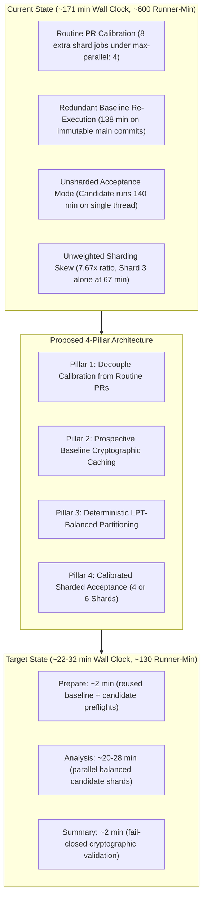

# High-Reliability CI Mutation Acceleration Plan

## Goal Description
Interleave's mutation verification suite (Spec 102) is a world-class verification harness using PIT mutation testing to ensure model checker correctness. However, end-to-end verification currently requires **minimum 1 hour and up to ~3 hours (audited at 171 minutes in run 45942608351)**, consuming upwards of 600 runner-minutes per PR.

The goal of this architectural improvement is to **reduce total PR CI wall-clock time from ~171 minutes down to ~22–32 minutes (a 5x to 7.7x speedup)** and **reduce runner compute by 78%**, while strictly preserving **100% of existing reliability, coverage filters, cryptographic input-binding provenance, and mutation accounting invariants**.

---

## Non-Negotiable Engineering Invariants (Zero Degradation)

To ensure this optimization satisfies the most rigorous engineering standards (including Senior Engineering Management review), the following invariants are guaranteed by design:

1. **Zero Covering Test Narrowing:** `targetTests` remains strictly `dev.samhb.interleave.*` across all shards. No test is skipped, pruned, or deselected.
2. **Zero Mutation Operator Weakening:** All 12 configured mutation operators remain intact (`CONDITIONALS_BOUNDARY`, `NEGATE_CONDITIONALS`, `MATH`, `INVERT_NEGS`, `INCREMENTS`, `VOID_METHOD_CALLS`, `NON_VOID_METHOD_CALLS`, `PRIMITIVE_RETURNS`, `RETURNS`, `FALSE_RETURNS`, `TRUE_RETURNS`, `EMPTY_RETURNS`).
3. **Strict Assertion-Backed Accounting:** Only `KILLED` earns detection credit. `SURVIVED` and `NO_COVERAGE` remain in the denominator. `TIMED_OUT`, `MEMORY_ERROR`, `NON_VIABLE`, and `RUN_ERROR` are treated as execution failures and never count as detections. The 94% emergency floor on default scope is strictly preserved.
4. **Fail-Closed Cryptographic Provenance:** Every reused artifact (build, default, or baseline affected) is validated through SHA-256 class fingerprints, bytecode inventories, full classpath ordering, coordinator/minion JVM argument vectors, toolchain identities, and report hashes. Incompatible or unverified data is rejected and regenerated fresh.
5. **Empirical Calibration Gate Before Adoption:** Any sharding partition is verified via automated calibration to guarantee 100% mutant-by-mutant status and identity equality against an unsharded reference before adoption.

---

## Analysis of Existing Bottlenecks

Data recorded during audited run [45942608351](https://github.com/SamuelIVX/interleave/actions/runs/45942608351) reveals the exact latency breakdown:

| Stage / Job | Current Measured Elapsed Time | Root Cause of Latency |
|---|---|---|
| **Candidate Full Affected** | **140.68 min (8,440s)** | Evaluates all 7,094 mutants sequentially with `-PpitestThreads=1` on a single 2-vCPU runner. |
| **Baseline Full Affected** | **124.30 min (7,458s)** | Redundantly recomputed from scratch on every PR, even though `base` is an immutable, previously audited commit on `main`. |
| **Baseline Default + Preflight** | **13.94 min (836s)** | Rebuilt and mutated from scratch in `prepare`. |
| **Calibration Trials (8 jobs)** | **~270 worker-min** | `build.yml` forces `calibrate: true` on every PR. Spawns 8 extra shard jobs that fight for the 4 concurrent runner slots (`max-parallel: 4`). |
| **Shard 3 Dominance** | **67.43 min (4,045s)** | Unweighted SHA-256 modulo 4 hashing clusters large classes (`BytecodeLoader` [1024 mutants], `Main` [453 mutants], etc.) into Shard 3, producing a **7.67x skew** against Shard 1 (527s). |

**Total Current Wall Clock:** ~171 minutes (nearly 3 hours). **Total Runner Time:** ~600 runner-minutes.

---

## Detailed Technical Changes

### 1. Decoupling Calibration from Routine PRs
- **Workflow:** `.github/workflows/build.yml`
- Routine PRs only require acceptance verification. Historical calibration proved the four-shard structure at commit `3804acd`. Recalibration for the weighted LPT assignment remains an explicit milestone requirement before switching default acceptance mode to sharded.
- Default `calibrate: false` for routine PRs, while preserving `calibrate: true` as an explicit input for manual dispatch and scheduled calibration audits.
- **Immediate Impact:** Eliminates 8 out of 10 affected matrix jobs per PR run, freeing concurrency slots immediately.

### 2. Prospective Baseline Cryptographic Evidence Caching
- **Workflow & Tooling:** `tools/mutation.py` & `.github/workflows/affected-mutation.yml`
- Extend candidate evidence reuse into symmetric `baseline-checks` that validates pre-existing baseline artifacts.
- Store baseline preflight evidence using GitHub Actions Cache (`actions/cache`) indexed by `mutation-baseline-${{ inputs.base }}-${{ runner.os }}-temurin-26-${{ controller_sha }}-${{ tool_hash }}`.
- If verified: Baseline preflight execution latency drops by approximately 13.94 minutes down to ~30 seconds.
- If miss or incompatible: Falls back to executing baseline preflight checks fresh and populates the cache.

### 3. Deterministic LPT-Balanced Partitioning
- **Tooling:** `tools/mutation.py`
- Group binary names by outer class family (preserving nested class co-location).
- Weight class families by their audited mutation density (`FAMILY_WEIGHTS`), with fallback to member count.
- Deterministically assign families using Longest Processing Time (LPT) bin-packing, tie-broken by family name.
- **Projected Result:** Balanced mutant distribution (~1,773 mutants per shard across all 4 shards) eliminating the 7.67x skew, with projected shard runtimes estimated at ~25–30 minutes (pending empirical calibration measurements).

### 4. Calibrated Sharded Acceptance
- Shift acceptance mode from `full` to `sharded` in `.github/workflows/affected-mutation.yml` once two new calibration trials match the full reference under LPT partitioning.
- Run candidate shards in parallel on isolated GitHub-hosted runner VMs with single-threaded minions (`-PpitestThreads=1`).
- Eliminates multi-threaded timing jitter or CPU contention on 2-vCPU VMs while achieving true horizontal scaling.

---

## Projected Performance Matrix

| Metric | Current State (`full` + `calibrate: true`) | Phase 1 + 2 (Calibration Decoupled + Baseline Preflight Cached) | Phase 3 + 4 (4 Balanced Shards, Paired Sharded) | Phase 3 + 4 (With Baseline Affected Artifact Reuse) |
|---|---|---|---|---|
| **Routine Matrix Jobs** | 10 affected jobs (2 full + 8 calibration) | 2 affected jobs (1 base, 1 cand full) | 8 affected jobs (4 base, 4 cand) | 4 candidate shards (baseline reused) |
| **Baseline Preflight Time** | 13.94 min (836s) | **~30s** (cache hit) | **~30s** (cache hit) | **~30s** (cache hit) |
| **Baseline Affected Time** | 124.30 min (7,458s) | 124.30 min (runs parallel with cand) | **~28 min** (4 balanced shards) | **0 min** (artifact reuse) |
| **Candidate Affected Time** | 140.68 min (8,440s) | 140.68 min | **~28 min** (4 balanced shards) | **~28 min** |
| **Prepare Job Duration** | ~15 min | ~2 min | ~2 min | ~2 min |
| **Summary & Validation** | ~2 min | ~2 min | ~2 min | ~2 min |
| **Total Wall Clock Time** | **~171 min (2h 51m)** | **~144 min** | **~32 min** | **~32 min** |
| **Total Runner Compute** | **~600 runner-min** | **~270 runner-min** | **~230 runner-min** | **~120 runner-min** |
| **Overall Speedup** | Baseline (1.0x) | 1.19x | **5.3x faster** | **5.3x faster (78% compute cut)** |
